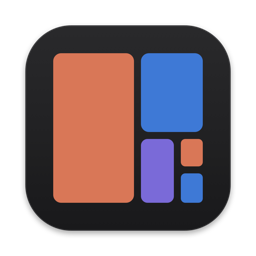
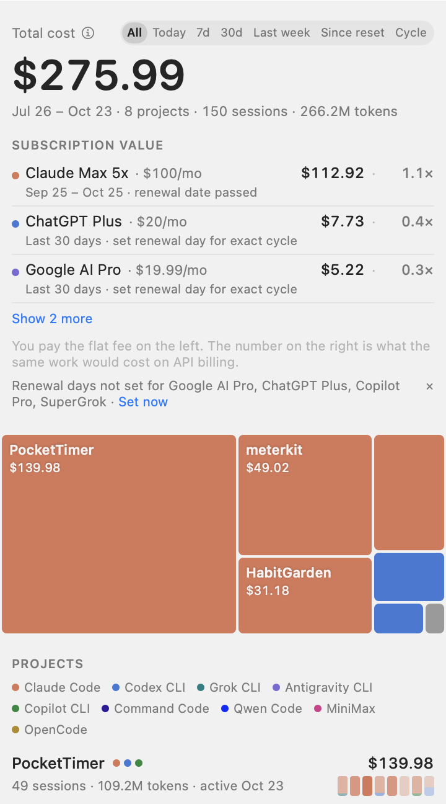
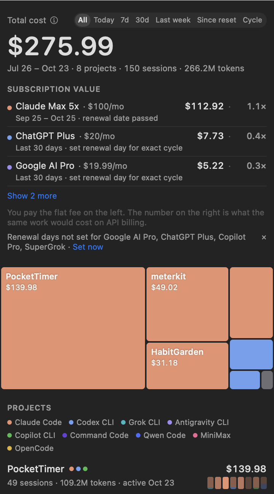
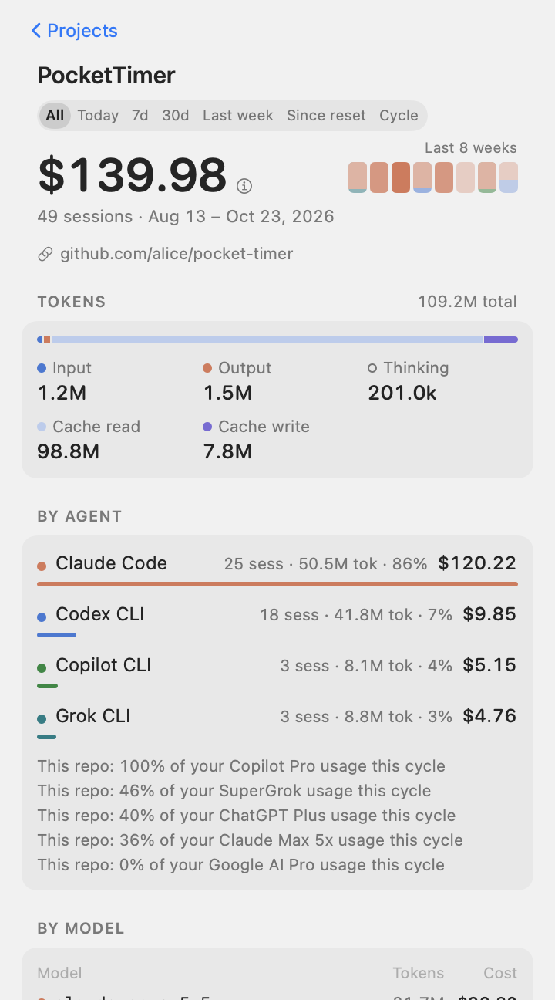
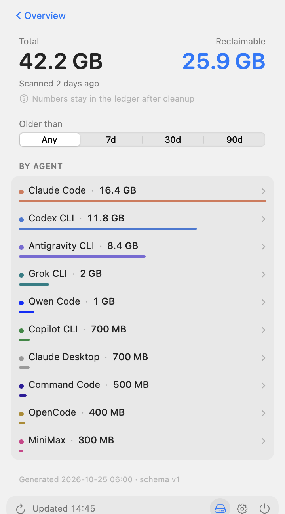

<p align="center">
  
</p>

<h1 align="center">Kanjo 勘定</h1>

<p align="center">
  <strong>How much AI money did each git repo cost?</strong><br>
  <sub>A macOS menu bar app and CLI that turn Claude Code, Codex, Antigravity, Grok, Qwen, Command Code, MiniMax, OpenCode and Copilot CLI logs into one bill per repo.</sub><br><br>
  <a href="#中文">中文</a> · <a href="https://github.com/mammut001/kanjo/releases/latest">Download</a> · <a href="ATTRIBUTION.md">How attribution works</a>
</p>

<p align="center">
  
  
  
  
  <a href="https://github.com/mammut001/kanjo/actions"></a>
</p>

---

<p align="center">
  
  
</p>

## Why

Usage dashboards tell you what you spent **today**. They don't tell you what **this repo** has cost since you started it, across every agent you threw at it.

Kanjo scans the local logs of your AI coding agents once, attributes every session to a git repo, and answers one question per project: what did it cost, in total. Not per day. Not per agent. Per repo, across all of them.

## What you get

- **A treemap of your repos by cost.** One glance tells you where the money went.
- **An 8-week burn strip per repo**, colored by agent across all 9 supported tools.
- **Subscription value for all agents.** Your plan's flat fee next to what this billing cycle's work would have cost on API billing, and the multiplier. Detected automatically for Claude, Codex, and Grok, or configured manually in Settings for any agent.
- **Time ranges**: all time, Today, 7 days, 30 days, last week, *since your last quota reset*, or *this billing cycle*.
- **Menu bar in cost or tokens mode.** Displays either spend (`$`) or total tokens with compact formatting and range suffixes.
- **Languages.** Fully localized into English, 简体中文, and Français, with localized token units (`k`/`M`/`B`, `万`/`亿`, `k`/`M`/`Md`).
- **Per-repo detail and overview model breakdown**: by agent, by model, by day, by branch, every session with how it was attributed, and the repo's share of each plan's cycle.
- **Disk.** How much space each agent's logs, scratch worktrees and caches take, what is safe to reclaim, and a cleanup that goes through the Trash. Your statistics stay in a permanent ledger, so deleting logs never deletes history.
- **Hide and pin** repos you don't care about or care about most.
- **Liquid Glass** on macOS 26, a plain material on 13–25.

<p align="center">
  
  
</p>

Every number is an **API-equivalent cost**: tokens × public API price. It is what the same work would have cost on pay-as-you-go billing. If you pay a subscription, it is not what you paid. The app shows this note via an ⓘ tooltip next to Total cost and does not let you hide it.

## Supported agents

| Agent | Logs read | Attributed by |
|---|---|---|
| Claude Code | `~/.claude/projects/**/*.jsonl` | files touched, cwd, scratchpad path |
| Codex CLI | `~/.codex/sessions/**/*.jsonl`, `~/.codex/archived_sessions/**` | files touched, cwd |
| Antigravity CLI | `~/.gemini/antigravity-cli/conversations/*.db` | files touched, workspace |
| Grok CLI | `~/.grok/sessions/**` | files touched, cwd |
| Qwen Code | `~/.qwen/chats/*.jsonl`, `~/.qwen/usage/token-usage-*.jsonl` | files touched, cwd |
| Command Code | `~/.commandcode/projects/**/*.jsonl` | files touched, cwd |
| MiniMax | `~/.minimax/sqlite.db` | files touched, workspace |
| OpenCode | `~/.local/share/opencode/opencode.db` | files touched, directory / worktree |
| Copilot CLI | `~/.copilot/session-state/**`, `~/.copilot/session-store.db` | files touched, cwd |

MiniMax and OpenCode shared sessions are identified and counted only once. Everything runs locally. Nothing is uploaded. Kanjo reads token counts, paths and timestamps; it never stores conversation text.

## How attribution works

A session is attributed by **what it touched**, not where it was started. Every file the agent read, wrote, or ran a command on scores a point for the repo that file lives in. One repo with 80 % or more of the points takes the whole session; otherwise the cost is split by points. Sessions that touched nothing fall back to their working directory, and sessions that cannot be placed go to an explicit *unattributed* bucket that is always shown.

A project is identified by its **git remote**, so worktrees, forks on disk, nested sub-repos without a remote and multiple clones all count as one project.

The full rules are in [ATTRIBUTION.md](ATTRIBUTION.md). The code implements them as written, and the totals reconcile on screen.

## Install

### App

Download `Kanjo-<version>-macos.dmg` from [Releases](https://github.com/mammut001/kanjo/releases/latest), open the DMG, drag `Kanjo.app` to Applications, then open the app. Releases are signed with a Developer ID; notarization is coming, so macOS may still block downloaded builds until then. The CLI is included: no separate CLI installation is needed. Python 3.9+ via Apple’s Xcode Command Line Tools is required; the app offers to open Apple’s installer when the tools are missing. It will ask once for access to the folders that hold your repos, because attribution reads `.git` files there.

### CLI only / use in a terminal

```bash
git clone https://github.com/mammut001/kanjo.git
cd kanjo && ./install.sh
```

This installs `kanjo` for terminal use; the app already includes its own CLI. Python 3.9+ and the standard library only.

```bash
kanjo doctor      # which logs were found
kanjo projects    # table of repos by cost
kanjo export      # the full JSON the app renders
```

### From source

```bash
cd ui && swift run Kanjo
```

Running from source uses the `cli/` directory next to it automatically.

### Build a notarized release

Release builds can be notarized with Apple’s notary service.

1. Store credentials once in your macOS keychain (generate an app-specific password at [appleid.apple.com](https://appleid.apple.com)):
   ```bash
   xcrun notarytool store-credentials kanjo-notary --apple-id <your-apple-id> --team-id Z5D5N7CU6L
   ```
2. Build, sign, and notarize:
   ```bash
   cd ui && KANJO_NOTARY_PROFILE=kanjo-notary ./package.sh
   # or pass --notarize (defaults to profile 'kanjo-notary'):
   cd ui && ./package.sh --notarize
   ```
This submits the app zip to Apple, staples the ticket to `Kanjo.app`, rebuilds the zip and DMG, signs the DMG, notarizes the DMG, and staples it.

## Configuration

Optional, at `~/.config/kanjo/attribution.toml`:

```toml
dominant_threshold = 0.8
exclude = ["/Users/me/scratch"]

[aliases]
"github.com/me/app" = ["github.com/me/app-fork", "/Users/me/old-app"]

[overrides]
"/Users/me/experiments/app-" = "github.com/me/app"

[quota_windows.claude]
weekly_reset = "tue 05:00"
# or: weekly_resets_at = "2026-10-27T10:00:00Z"
weekly_window_hours = 168
```

Quota reset times are read from [Tokei](https://github.com/cclank/tokei)'s cache when it is installed (Claude, Codex, Grok), and can be set by hand in Settings or as above.

## Repository layout

```
ATTRIBUTION.md   attribution rules (normative)
CONTRACT.md      JSON format between CLI and app (the only interface)
cli/             Python CLI: parsers, attribution, pricing, export
ui/              SwiftUI menu bar app (SwiftPM; KanjoCore library + Kanjo executable)
```

The CLI and the app are developed independently and meet only at the JSON in [CONTRACT.md](CONTRACT.md). Pricing comes from Tokei's `pricing.json` (MIT); models missing from the table are priced by their closest known relative and marked *estimated*.

## Kanjo and Tokei

[Tokei](https://github.com/cclank/tokei) (時計, clock) watches your quotas and daily usage across 30+ tools. Kanjo (勘定, the bill) asks a different question: the total bill of one repo. They read the same logs and share a price table, nothing else. Use both.

## License

MIT.

---

<a name="中文"></a>

<h1 align="center">Kanjo 勘定</h1>

<p align="center"><strong>每个 git repo 一共花了多少 AI 钱？</strong></p>

用量面板告诉你**今天**花了多少。它不会告诉你**这个项目**从开工到现在、换了几个 agent，一共烧了多少。

Kanjo 扫一遍本机 AI 编程工具的日志，把每个会话归到一个 git 仓库，然后按项目算账：不按天，不按工具，按 repo，跨所有 agent。

### 功能

- **按花费的 treemap**：一眼看出钱去哪了。
- **每个 repo 一条 8 周燃烧热力条**，按 9 种 agent 分色，每周花费构成一目了然。
- **所有 agent 的订阅价值**：左边是你实际付的月费，右边是本账期的活按 API 计费要多少，以及倍数。Claude、Codex、Grok 自动识别，其他 agent 均可在设置中手动配置。
- **时间范围**：全部、**今天**、7 天、30 天、上周、自上次额度重置以来、或本账期。
- **菜单栏金额与 Token 模式**：可在设置中切换显示金额或 Token 数，带紧凑进位与时间范围后缀。
- **多语言界面**：原生支持 English、简体中文与 Français，以及本地化的 Token 计数单位（万/亿、k/M/B、k/M/Md）。
- **项目详情与总览模型分布**：按 agent、按模型、按天、按分支，每个会话是怎么归属的，以及这个 repo 占了你各订阅本账期的多少。
- **Disk**：每个工具的日志、临时 worktree、缓存各占多少空间，哪些能安全回收，清理走废纸篓。统计数据存在永久账本里，删日志不丢历史。
- **隐藏与置顶**。
- macOS 26 用 **Liquid Glass**，13 到 25 用普通材质。

所有数字都是 **API 等价成本**：token 乘以公开 API 单价。订阅用户的实际支出不是这个数，app 在 Total cost 旁的 ⓘ 提示中醒目标注，并且不能隐藏。

### 支持的工具

| 工具 | 读取的日志 | 归属依据 |
|---|---|---|
| Claude Code | `~/.claude/projects/**/*.jsonl` | 碰过的文件、当前工作目录、scratchpad 路径 |
| Codex CLI | `~/.codex/sessions/**/*.jsonl`、`~/.codex/archived_sessions/**` | 碰过的文件、当前工作目录 |
| Antigravity CLI | `~/.gemini/antigravity-cli/conversations/*.db` | 碰过的文件、工作区 |
| Grok CLI | `~/.grok/sessions/**` | 碰过的文件、当前工作目录 |
| Qwen Code | `~/.qwen/chats/*.jsonl`、`~/.qwen/usage/token-usage-*.jsonl` | 碰过的文件、当前工作目录 |
| Command Code | `~/.commandcode/projects/**/*.jsonl` | 碰过的文件、当前工作目录 |
| MiniMax | `~/.minimax/sqlite.db` | 碰过的文件、工作区 |
| OpenCode | `~/.local/share/opencode/opencode.db` | 碰过的文件、目录／worktree |
| Copilot CLI | `~/.copilot/session-state/**`、`~/.copilot/session-store.db` | 碰过的文件、当前工作目录 |

MiniMax 与 OpenCode 的共享会话仅计一次。全部本地运行，不上传任何东西，只读 token 数、路径和时间戳，不存对话内容。

### 归属规则

会话按**它碰过的文件**归属，而不是在哪里启动。每个文件操作给文件所在的仓库记一分；一个仓库拿到 80% 以上就整个会话归它，否则按比例拆分。什么都没碰的按工作目录兜底，兜不住的进一个永远显示的「未归属」桶。项目身份是 git remote，所以 worktree、fork、无 remote 的子仓库和多个 clone 都算一个项目。完整规则见 [ATTRIBUTION.md](ATTRIBUTION.md)。

### 安装

从 [Releases](https://github.com/mammut001/kanjo/releases/latest) 下载 `Kanjo-<版本>-macos.dmg`，打开 DMG，把 `Kanjo.app` 拖进「应用程序」，再打开应用。发布包使用 Developer ID 签名；公证即将加入，在此之前 macOS 仍可能拦截下载的应用。CLI 已内置，无需另外安装。需要 Xcode Command Line Tools 提供的 Python 3.9+；缺少工具时，应用可打开 Apple 安装对话框。首次运行可能请求访问仓库文件夹。

仅需 CLI／在终端中使用：

```bash
git clone https://github.com/mammut001/kanjo.git
cd kanjo && ./install.sh
```

### 构建公证发布包

发布包支持通过 Apple 公证服务进行公证。

1. 在 macOS 钥匙串中保存一次凭据（在 [appleid.apple.com](https://appleid.apple.com) 生成 App 专用密码）：
   ```bash
   xcrun notarytool store-credentials kanjo-notary --apple-id <你的-apple-id> --team-id Z5D5N7CU6L
   ```
2. 打包、签名并公证：
   ```bash
   cd ui && KANJO_NOTARY_PROFILE=kanjo-notary ./package.sh
   # 或使用 --notarize 参数（默认使用 'kanjo-notary' profile）：
   cd ui && ./package.sh --notarize
   ```
该流程会将应用提交至 Apple 公证服务，装订（staple）公证票据至 `Kanjo.app`，重新构建 zip 与 DMG，对 DMG 签名并完成公证与装订。

### 和 Tokei 的关系

[Tokei](https://github.com/cclank/tokei)（時計）看额度和每日用量，Kanjo（勘定）看一个 repo 的总账。两者读同样的日志、共用一份价格表，仅此而已。

MIT 协议。
