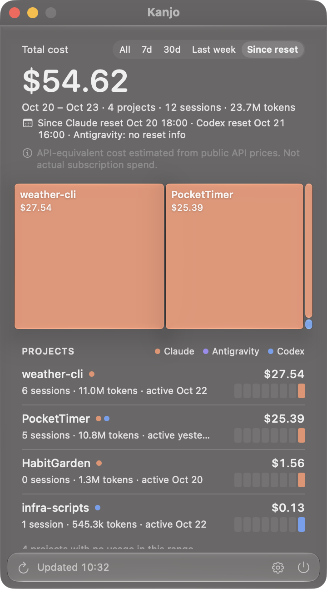

<p align="center">
  
</p>

<h1 align="center">Kanjo 勘定</h1>

<p align="center">
  <strong>How much AI money did each git repo cost?</strong><br>
  <sub>A macOS menu bar app and CLI that turn Claude Code, Codex and Antigravity logs into one bill per repo.</sub><br><br>
  <a href="#中文">中文</a> · <a href="https://github.com/mammut001/kanjo/releases/latest">Download</a> · <a href="ATTRIBUTION.md">How attribution works</a>
</p>

<p align="center">
  
  
  
  
  <a href="https://github.com/mammut001/kanjo/actions"></a>
</p>

---

<p align="center">
  
  
</p>

## Why

Usage dashboards tell you what you spent **today**. They don't tell you what **this repo** has cost since you started it, across every agent you threw at it.

Kanjo scans the local logs of your AI coding agents once, attributes every session to a git repo, and answers one question per project: what did it cost, in total. Not per day. Not per agent. Per repo, across all of them.

## What you get

- **A treemap of your repos by cost.** One glance tells you where the money went.
- **An 8-week burn strip per repo**, colored by agent, so you can see which weeks were Claude and which were Codex.
- **Time ranges**: all time, 7 days, 30 days, last week, or *since your last quota reset* (read from Tokei's cache, or set by hand).
- **Per-repo detail**: by agent, by model, by day, by branch, and every session with how it was attributed.
- **Hide and pin** repos you don't care about or care about most.
- **Liquid Glass** on macOS 26, a plain material on 13–25.

<p align="center">
  
  
</p>

Every number is an **API-equivalent cost**: tokens × public API price. It is what the same work would have cost on pay-as-you-go billing. If you pay a subscription, it is not what you paid. The app says so on every screen and does not let you hide the note.

## Supported agents

| Agent | Logs read | Attributed by |
|---|---|---|
| Claude Code | `~/.claude/projects/**/*.jsonl` | files touched, cwd, scratchpad path |
| Codex CLI | `~/.codex/sessions/**/*.jsonl` | files touched, cwd |
| Antigravity CLI | `~/.gemini/antigravity-cli/conversations/*.db` | files touched, workspace |

Everything runs locally. Nothing is uploaded. Kanjo reads token counts, paths and timestamps; it never stores conversation text.

## How attribution works

A session is attributed by **what it touched**, not where it was started. Every file the agent read, wrote, or ran a command on scores a point for the repo that file lives in. One repo with 80 % or more of the points takes the whole session; otherwise the cost is split by points. Sessions that touched nothing fall back to their working directory, and sessions that cannot be placed go to an explicit *unattributed* bucket that is always shown.

A project is identified by its **git remote**, so worktrees, forks on disk, nested sub-repos without a remote and multiple clones all count as one project.

The full rules are in [ATTRIBUTION.md](ATTRIBUTION.md). The code implements them as written, and the totals reconcile on screen.

## Install

### App

Download `Kanjo-<version>-macos.zip` from [Releases](https://github.com/mammut001/kanjo/releases/latest), unzip, drag `Kanjo.app` to Applications. The app is ad-hoc signed; on first launch right-click → Open. It will ask once for access to the folders that hold your repos, because attribution reads `.git` files there.

### CLI (needed by the app)

```bash
git clone https://github.com/mammut001/kanjo.git
cd kanjo && ./install.sh
```

This puts `kanjo` on your PATH and installs the CLI where the app looks for it. Python 3.9+ and the standard library only.

```bash
kanjo doctor      # which logs were found
kanjo projects    # table of repos by cost
kanjo export      # the full JSON the app renders
```

### From source

```bash
cd ui && swift run Kanjo
```

Running from source uses the `cli/` directory next to it automatically.

## Configuration

Optional, at `~/.config/kanjo/attribution.toml`:

```toml
dominant_threshold = 0.8
exclude = ["/Users/me/scratch"]

[aliases]
"github.com/me/app" = ["github.com/me/app-fork", "/Users/me/old-app"]

[overrides]
"/Users/me/experiments/app-" = "github.com/me/app"

[quota_windows.claude]
weekly_resets_at = "2026-10-27T10:00:00Z"
weekly_window_hours = 168
```

Quota reset times are read from [Tokei](https://github.com/cclank/tokei)'s cache when it is installed, and can be set by hand as above.

## Repository layout

```
ATTRIBUTION.md   attribution rules (normative)
CONTRACT.md      JSON format between CLI and app (the only interface)
cli/             Python CLI: parsers, attribution, pricing, export
ui/              SwiftUI menu bar app (SwiftPM; KanjoCore library + Kanjo executable)
```

The CLI and the app are developed independently and meet only at the JSON in [CONTRACT.md](CONTRACT.md). Pricing comes from Tokei's `pricing.json` (MIT); models missing from the table are priced by their closest known relative and marked *estimated*.

## Kanjo and Tokei

[Tokei](https://github.com/cclank/tokei) (時計, clock) watches your quotas and daily usage across 30+ tools. Kanjo (勘定, the bill) asks a different question: the total bill of one repo. They read the same logs and share a price table, nothing else. Use both.

## License

MIT.

---

<a name="中文"></a>

<h1 align="center">Kanjo 勘定</h1>

<p align="center"><strong>每个 git repo 一共花了多少 AI 钱？</strong></p>

用量面板告诉你**今天**花了多少。它不会告诉你**这个项目**从开工到现在、换了几个 agent，一共烧了多少。

Kanjo 扫一遍本机 AI 编程工具的日志，把每个会话归到一个 git 仓库，然后按项目算账：不按天，不按工具，按 repo，跨所有 agent。

### 功能

- **按花费的 treemap**：一眼看出钱去哪了。
- **每个 repo 一条 8 周燃烧热力条**，按 agent 分色，哪周是 Claude、哪周是 Codex 看得出来。
- **时间范围**：全部、7 天、30 天、上周、或**自上次额度重置以来**（从 Tokei 缓存读，也可手动设置）。
- **项目详情**：按 agent、按模型、按天、按分支，以及每个会话是怎么归属的。
- **隐藏与置顶**。
- macOS 26 用 **Liquid Glass**，13 到 25 用普通材质。

所有数字都是 **API 等价成本**：token 乘以公开 API 单价。订阅用户的实际支出不是这个数，app 每一屏都写着这句话，并且不能隐藏。

### 支持的工具

Claude Code、Codex CLI、Antigravity CLI。全部本地运行，不上传任何东西，只读 token 数、路径和时间戳，不存对话内容。

### 归属规则

会话按**它碰过的文件**归属，而不是在哪里启动。每个文件操作给文件所在的仓库记一分；一个仓库拿到 80% 以上就整个会话归它，否则按比例拆分。什么都没碰的按工作目录兜底，兜不住的进一个永远显示的「未归属」桶。项目身份是 git remote，所以 worktree、fork、无 remote 的子仓库和多个 clone 都算一个项目。完整规则见 [ATTRIBUTION.md](ATTRIBUTION.md)。

### 安装

从 [Releases](https://github.com/mammut001/kanjo/releases/latest) 下载 `Kanjo-<版本>-macos.zip`，解压拖进「应用程序」。首次打开右键 → 打开。然后装 CLI：

```bash
git clone https://github.com/mammut001/kanjo.git
cd kanjo && ./install.sh
```

### 和 Tokei 的关系

[Tokei](https://github.com/cclank/tokei)（時計）看额度和每日用量，Kanjo（勘定）看一个 repo 的总账。两者读同样的日志、共用一份价格表，仅此而已。

MIT 协议。
